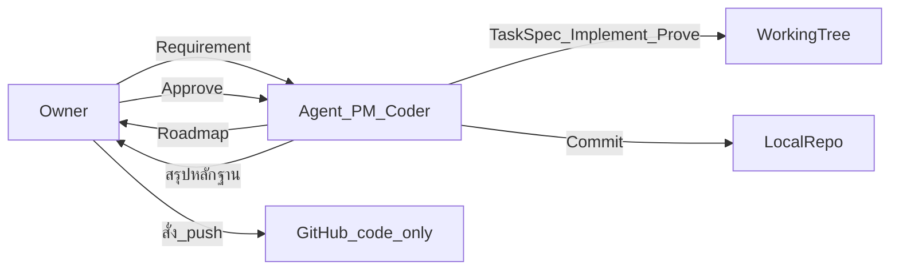

# Workflow — Owner / Agent (PM+Coder รวมแชทเดียว)

ทีมย่อม: รับ Requirement → Roadmap → รอ Approve → Task Spec → ทำ+พิสูจน์ → **commit** → (push เมื่อ Owner สั่ง)

## บทบาท
| บทบาท | ที่อยู่ | หน้าที่หลัก |
|--------|---------|-------------|
| Owner | ผู้ใช้ | Requirement, Approve Roadmap, เทส UX, สั่ง push |
| Agent | แชทเดียว (`@role-agent`) | วางแผน + implement + self-QC + **commit** — สวมหมวก PM และ Coder คนเดียวกัน |
| Sub-agents | ให้ Agent สั่งเมื่อจำเป็น | วิจัย / สำรวจ / วิเคราะห์ — ไม่แทนงานหลักทั้งก้อนโดยไม่มี Approve |

## Work Breakdown (3 ระดับ)
| ระดับ | ความหมาย |
|-------|----------|
| Phase | ระยะ/ส่วนประกอบหลักของระบบ |
| Milestone | จุดหมายย่อยที่ทดสอบได้ |
| Task | งาน actionable + Tech Note |

รายละเอียด: `docs/roadmaps/` และ [handoff.md](handoff.md)

## ลำดับงานมาตรฐาน

1. Owner ส่ง Requirement
2. Agent ถามจุดกำกวม → วิเคราะห์ → สร้าง Roadmap — **ยังไม่เขียนโค้ดระบบหลัก**
3. Owner **Approve** หรือขอแก้
4. Agent เขียน Task Spec ของ Current Task (เกณฑ์ผ่าน + หลักฐาน)
5. Agent implement เฉพาะ Task นั้น
6. Agent พิสูจน์ด้วยหลักฐานจริง (เทส/คำสั่ง/พฤติกรรม)
7. ผ่านเกณฑ์ → **Agent commit** (ท้องถิ่น) — ยังไม่ push จนกว่า Owner สั่ง
8. ไม่ผ่าน → แก้ในแชทนี้จนหลักฐานครบ แล้วค่อย commit
9. Task ถัดไปตาม Roadmap

## QA / QC
- **Agent (หมวก Coder):** self-QC + หลักฐานก่อนถือว่าปิด Task
- **Agent (หมวก PM):** เทียบเกณฑ์ Task กับหลักฐานทีละข้อ ก่อน commit
- **Owner:** acceptance / UX; สั่ง push

## Git
- **Commit** เมื่อ Task ผ่านและมีหลักฐาน — ทำเป็นนิสัยหลังงานเสร็จ
- **Push** เฉพาะเมื่อ Owner สั่ง
- ห้าม commit secret / API key / credential DB
- **ขอบเขตไฟล์:**
  - **โค้ด:** commit ได้ + **push ได้** เมื่อ Owner สั่ง
  - **`docs/`** และ **schema:** commit ท้องถิ่นได้ — **ห้าม push ขึ้น GitHub**
  - แนะนำแยก commit โค้ด vs docs/schema
  - **ห้ามใช้ `.gitignore`** ตัด docs/schema ออกจาก git เพื่อจุดประสงค์นี้
